# Решение о выпуске — видимые правки, 14.10

Для владельца. По каждой ветке: что меняется, ссылка на изменения, скриншоты «до/после» и проверки. Решение — «выпускать» или «нет» по строке. Выпуск идёт штатно (`factory cell trigger`), затем сверка на живом сайте.

**Как сняты скриншоты.**
- «До» — выпущенный код, «после» — ветка. Обе стороны подняты на одной копии снимка ячейки; данные ячейки только читаются.
- Lords — урезанный снимок (`mini/<repo>`), поэтому вместо постеров буквы-заглушки. Это ограничение стенда, не правки.
- Внешние запросы (плеер, счётчики) обрывались.
- Для AnimeGo, где `player.json` закрыт от сессии, — штатный `checks/stand_root.py`.
- `img/*-live.jpg` — живая страница с оборванными внешними запросами.

## Сводка

| # | Сайт | Ветка | Что меняется | Проверки | Риск |
| --- | --- | --- | --- | --- | --- |
| 1 | lordserials22.info | [`claude/review-lords-t072`](https://github.com/sbc-create/site-lordserials22-info/compare/ff8a4b0...claude/review-lords-t072) f93fa23 | T072 + T076: см. §1 | run.sh 38 PASS / 0 FAIL; новые проверки: прежний код rc=1, ветка rc=0 | низкий |
| 2 | lordfilm47.space | [`claude/review-lords-t054`](https://github.com/sbc-create/site-lordfilm47-space/compare/1112880...claude/review-lords-t054) 7a4a392 | T054: в подвале «Жанры» вместо закрытого от индекса «западный контент» — следующий жанр («криминал») | home_genre_links: прежний rc=1, ветка rc=0; run.sh 38 PASS | низкий |
| 3 | animedia.space | [`claude/review-anime-t071`](https://github.com/sbc-create/site-animedia-space/compare/474c553...claude/review-anime-t071) 5ba45c5 | T071: строка «Следующая серия: N серия — дата (МСК)» на странице тайтла из снимка расписания | next_episode_title: прежний rc=1, ветка rc=0; run.sh rc=0 | низкий |
| 4 | animeg0.site | [`claude/review-anime-t071`](https://github.com/sbc-create/site-animeg0-site/compare/c8bb9ec...claude/review-anime-t071) d7e854e | T071, то же для AnimeGo (класс .ag-next) | next_episode_title на копии живого снимка: PASS «3 серия — 18 октября, вс, 11:00 (МСК)»; CI success 38554685026 | низкий |
| 5 | animedia.icu | [`claude/review-anime-t071`](https://github.com/sbc-create/site-animedia-icu/compare/f7694c4...claude/review-anime-t071) 6547bca | T071, исходный образец | прежний rc=1, ветка rc=0 (13.10) | низкий |
| 6 | Zona ×3 | `claude/review-zona-batchb`: [zonafilm12](https://github.com/sbc-create/site-zonafilm12-site/compare/7ecfdb1...claude/review-zona-batchb) b68e1fd, [zonafilm.cc](https://github.com/sbc-create/site-zonafilm-cc/compare/b5742cb...claude/review-zona-batchb) 5a001ec, [zonafilm.space](https://github.com/sbc-create/site-zonafilm-space/compare/81e717e...claude/review-zona-batchb) 5868d7b | T034, T039 (видимые), T044, T046 (невидимые), см. §6 | zonafilm12 run.sh 41 PASS / 0 FAIL; catalog_scope, catalog_genre_links (97), sitemap_genres_race — rc=0 | средний: см. §6 |

Все ветки содержат выпущенный код целиком: выпуск не откатит канарейки T074/T075 и правки ночи. T072 перебазирован на ff8a4b0 — без этого выпуск убрал бы канарейку T075.

## 1. lordserials22.info — T072 + T076

**T072.** `/anime/` и `/dorama/` получали title «Каталог: смотреть онлайн — …», H1 «Каталог» и описание «Каталог на …», как `/catalog/`. Три индексируемых раздела с одним title.

| | title | H1 | description |
| --- | --- | --- | --- |
| до | Каталог: смотреть онлайн — Lordserials Animation | Каталог | Каталог на Lordserials Animation: 393 записи каталога — смотреть онлайн. |
| после | Аниме: смотреть онлайн — Lordserials Animation | Аниме | Аниме на Lordserials Animation: 393 записи каталога — смотреть онлайн. |

`/dorama/` — так же, «Дорамы». `/catalog/` не меняется. Число 393 — урезанный стенд; на живом сайте число раздела своё.

**T076** (найдено сегодня на живом сайте):
- было: плашка «section: anime» и кнопка «Сбросить» — внутреннее имя ключа показано как выбранное условие, хотя посетитель ничего не выбирал;
- стало: плашки нет; у остальных Lords разделы вида и так без плашек;
- выбранный год по-прежнему даёт плашку «Год» и «Сбросить» — это тоже проверяется.

| | до | после |
| --- | --- | --- |
| мобильный | 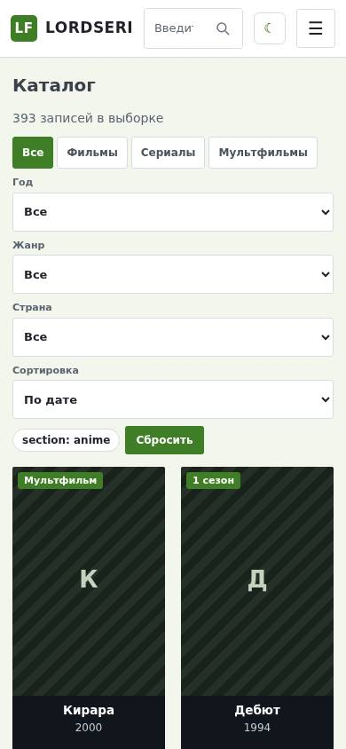 | 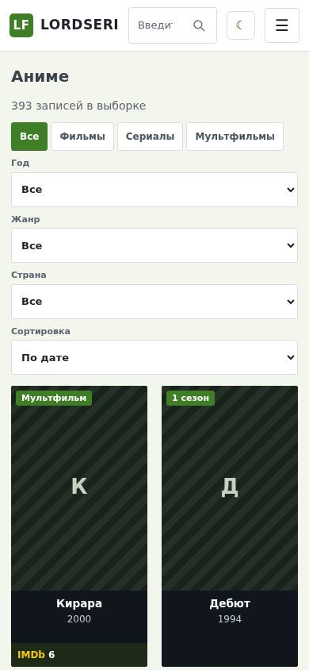 |
| фильтр, компьютер | 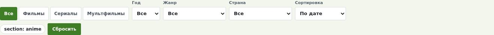 |  |

Полные кадры: `img/t072-{anime,dorama}-{desktop,mobile}-{before,after}.jpg`.

## 2. lordfilm47.space — T054

Подвал главной, колонка «Жанры»: первой стояла ссылка «западный контент». Её раздел закрыт от индекса как служебная метка (T044) — ссылка с каждой страницы вела в noindex. Теперь служебные метки пропускаются, восьмой слот получает «криминал».

| до | после |
| --- | --- |
| 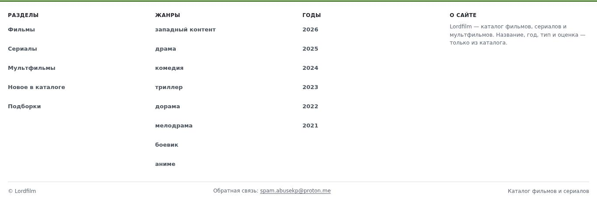 | 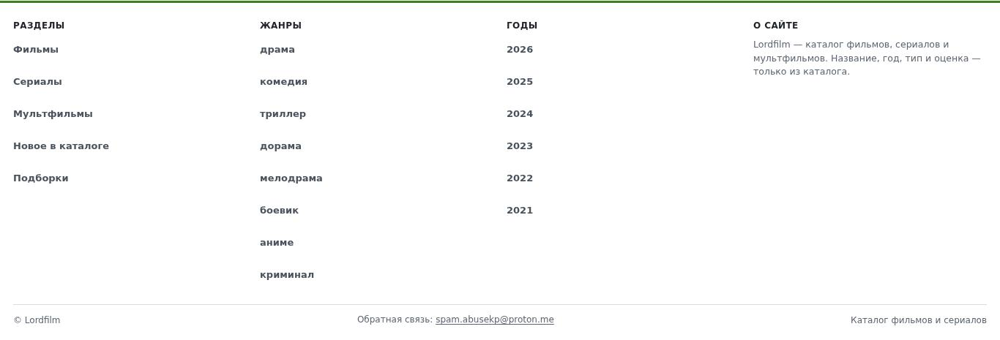 |

## 3–5. «Следующая серия» — animedia.space, animeg0.site (animedia.icu — образец)

Строка под панелью действий: «Следующая серия: 3 серия — 18 октября, вс, 11:00 (МСК)».
- Берётся из того же снимка расписания, что `/schedule/`.
- Только будущий выход и только у свежего расписания (`stale=false`). Нет события — нет строки.
- В description дата не идёт: сниппет кешируется и устарел бы.
- Основание — аудит 13.10 §11: запросы «<название> дата выхода серий», позиция около 10, а даты на странице не было.

| | до | после |
| --- | --- | --- |
| animedia.space, компьютер | 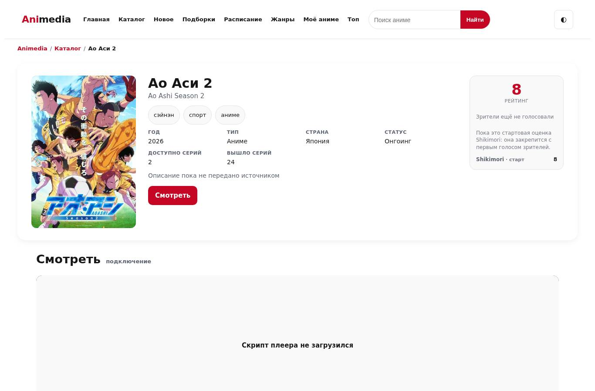 |  |
| animedia.space, строка | — |  |
| animeg0.site, мобильный |  | 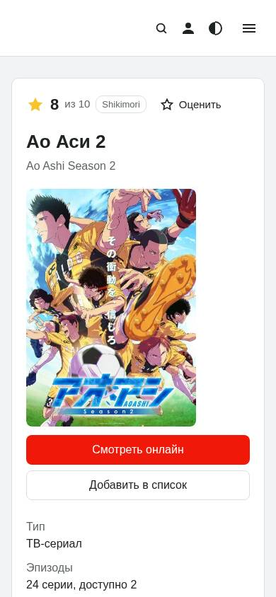 |
| animeg0.site, строка | — | 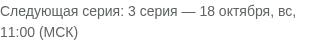 |

На мобильном строка ниже первого экрана — после характеристик.

## 6. Zona — T034, T039 (видимые), T044, T046

**T039.** На голом `/catalog/` вместо «Результаты в этой выборке» и ссылки «Сбросить» — «Результаты в каталоге», без «Сбросить». Условий нет, сбрасывать нечего.

| до | после |
| --- | --- |
| 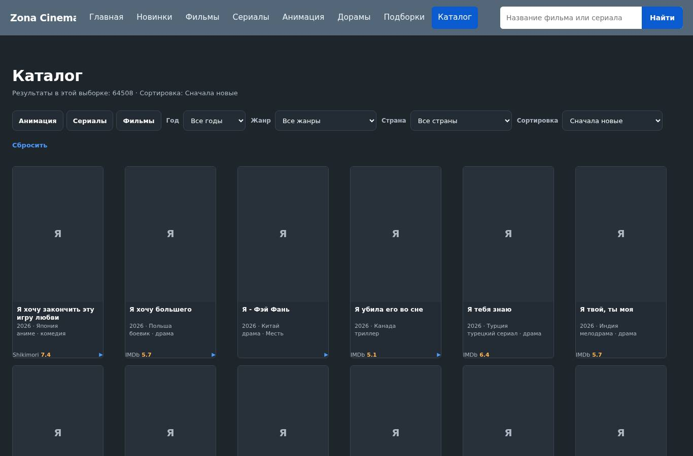 | 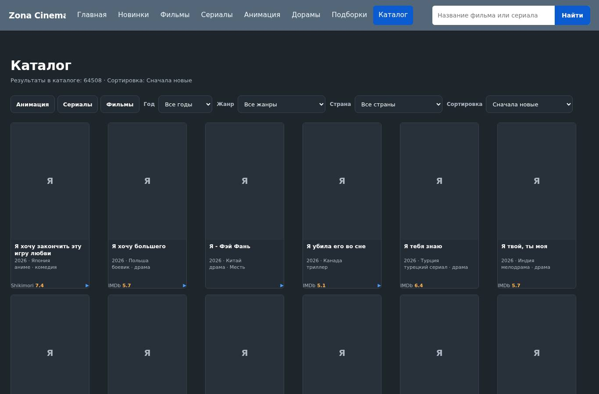 |

**T034.** На голом `/catalog/` — блок «Жанры»: 97 ссылок на разделы жанров (набор тот же, что в карте сайта). Сейчас с `/catalog/` на разделы жанров не ведёт ни одной ссылки.

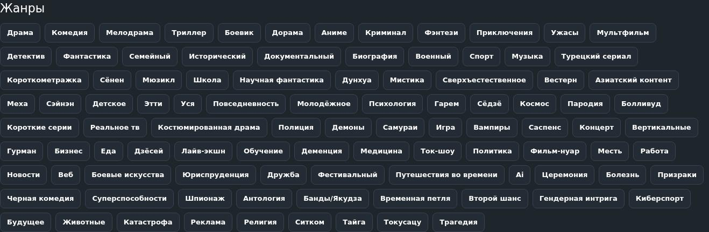

**Замечание к T034 — решить до выпуска.**
- В блоке и в живой карте есть «Азиатский контент» (`?genre=aziatskiykontent`, сейчас 200 и index).
- На Lords та же метка признана служебной и закрыта от индекса (T064). На Zona закрыт только «западный контент» (T044).
- Предложение: выпускать T034 вместе с правкой «азиатский контент — служебная метка» (новая задача T077 в очереди): метка уходит из блока и карты, раздел — noindex.
- Без T077 блок добавит ещё одну ссылку на раздел-метку поставщика.

**Невидимые:**
- T044 — раздел «западный контент» noindex, follow;
- T046 — description главной пересказывает видимый блок. Было «Zona Cinema: фильмы, сериалы и анимация.», стало «… — высокие оценки недели, недавние поступления и каталог с фильтрами по виду, жанру, году и стране.»;
- правки CI;
- `launcher-refuses` (только zonafilm12, b68e1fd) — см. ниже.

### launcher-refuses — причина найдена, проверка усилена, не отключена

- **Причина.** Шаг падал, когда checks/run.sh запускали с `SITE_DATA_DIR` (его требуют проверки на живом снимке). `run.py` берёт каталог и из окружения, поэтому проба «запуск без каталога» каталог получала и не отказывала. Это провал окружения прогона, а не рабочей копии — прежнее объяснение («только в рабочих копиях») было неверным.
- **Правка (b68e1fd)** — только ужесточает шаг:
  - проба идёт без `SITE_DATA_DIR`;
  - отказ обязан называть причину: «каталог данных не задан» в первой пробе, подставленный путь во второй.
- **Мутант** (run.py молча берёт чужой каталог по умолчанию): прежний шаг rc=0 — пропустил бы; новый — rc=1.
- **Итог:** полный run.sh под `SITE_DATA_DIR` — 41 PASS, 0 FAIL.
- Та же проверка в остальных репозиториях — тем же переносом после одобрения.
